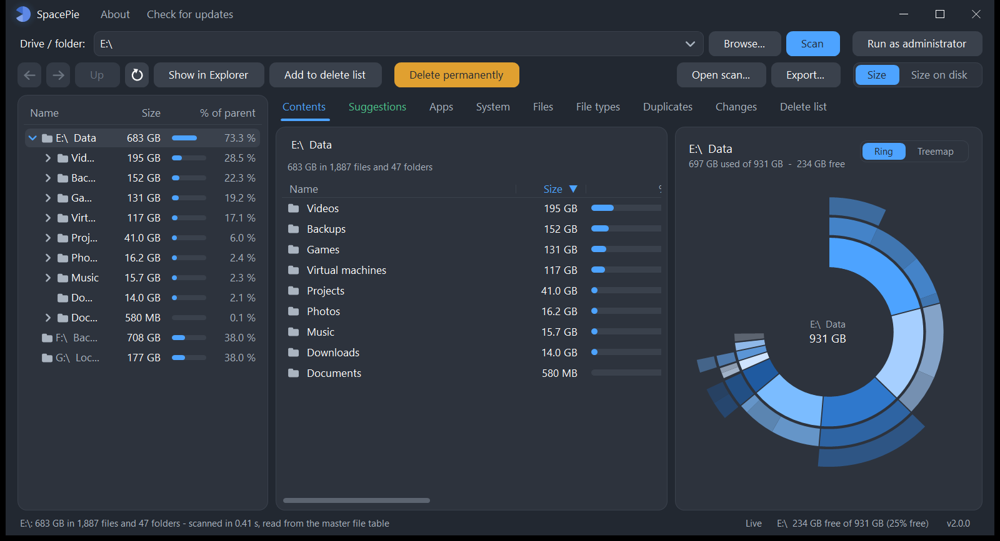
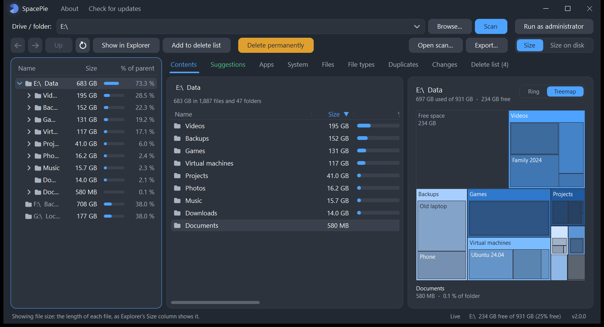
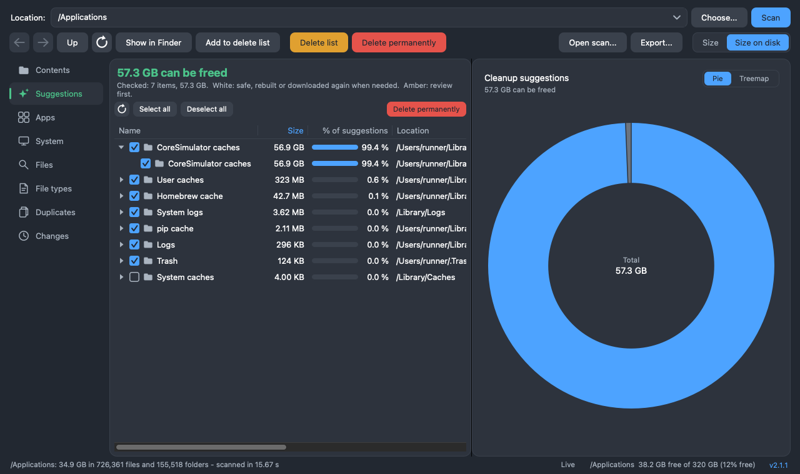
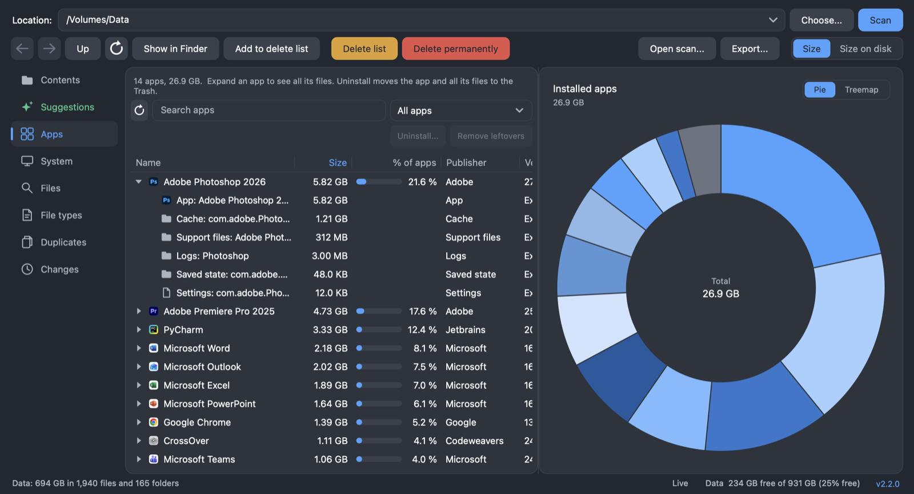
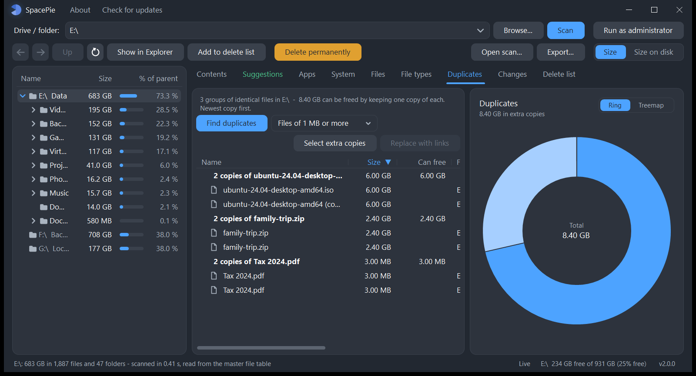
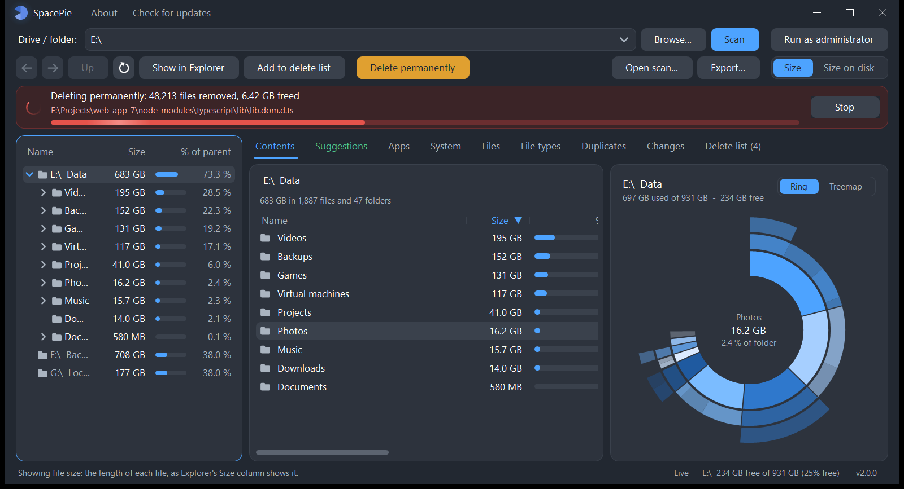
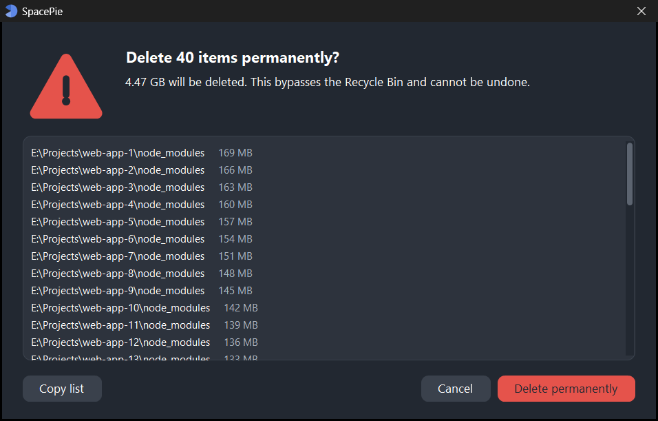

<p align="center">
  
</p>

<h1 align="center">SpacePie</h1>

<p align="center">The fastest free disk space analyzer and cleaner for <b>Windows</b> and <b>macOS</b>.<br>
Open source, a single small app, nothing to install.<br>
<sub>Formerly <i>Disk Space Analyzer</i>.</sub></p>

<p align="center"><a href="../../releases/latest"><b>Download the latest release</b></a></p>



It starts analyzing your system drive the moment it opens. See where your space
went, find big, old and duplicate files, follow cleanup suggestions, uninstall
apps together with everything they left behind, and delete what you don't need,
to the Recycle Bin / Trash or permanently.

## Features

**Fast scanning**

- **A whole drive in seconds.** On Windows, run as administrator and it reads an
  NTFS drive's master file table directly: over a million files in about ten
  seconds. Otherwise, and on macOS, it scans folders in parallel with the
  operating system's fastest directory calls.
- **Starts right away, in the background.** A start-up screen shows what is
  being loaded the moment you launch it, without slowing the start. The system
  drive is scanned when the app opens, with progress and **Cancel**; you can
  browse while it runs, and the chart pane shows the animated logo until the
  scan is done, then turns into the chart. Other drives and USB disks are
  listed and scanned when you ask.
- **Instant restart.** When you close it, the scan of each drive is saved; the
  next start shows it at once (a whole system drive in under two seconds). On
  Windows as administrator it then reads only what changed since, from the
  drive's NTFS change journal (on macOS, from the file system's event history),
  instead of scanning again; otherwise it rescans in the background while you
  browse the saved scan.
- **Live updates.** Files that appear, change or go away update the results
  within seconds, without rescanning.
- **Size on disk** (the default) or **file size**, switched with one click.
  Compressed files count what they really take, hard links count once (Windows:
  in administrator scans of whole drives), and cloud
  files that are not downloaded (OneDrive online-only, iCloud) count nothing and
  are never downloaded by the scan.

**Seeing where the space went** (tabs above the list; the chart always shows the
open list, and hovering a slice highlights its row and the other way round)

- **Ring or treemap:** the chart pane shows the open list as a ring chart or as a
  treemap (rectangles sized by space, folders with their subfolders inside), one
  click to switch; the choice is remembered.
- **Back, Forward and a path bar:** go back to the folders you opened (also with
  the mouse side buttons), and jump to any parent from the path above the list.
- **What it is:** well-known folders and files (the Windows component store,
  `hiberfil.sys`, browser and developer caches, iPhone backups, Xcode data,
  `node_modules`...) are named in their own column, with whether they can go and
  where to clean them up properly; hover for the full explanation.
- **Nothing hidden:** when folders could not be read (no permission), a banner
  says how many and lists them, instead of quietly leaving them out of the totals.

- **Contents:** the selected folder's subfolders and files with size, share,
  change since the last scan, counts and dates. The ring chart shows the folder
  and, in two outer rings, its subfolders. Click a part to open it; click the
  centre (the folder's name) to go back up. For a drive it also shows free space.
- **The chart, in every tab:** every item of at least 2 % of the total (7.2° of
  the circle) gets a slice of its own, in true proportion; all smaller items
  together form one grey "N smaller items" slice.
- **Suggestions** (the green tab next to Contents): how much can be freed, in
  large print, and what: the Recycle Bin / Trash, temporary files, caches
  (browsers, developer tools, Xcode, Homebrew...), the `node_modules` folders of
  your own projects (never those inside installed programs or editors), old
  installers in Downloads, and more, each with what deleting it means. Expand a
  suggestion to see every location, check exactly what you want (**Select all** /
  **Deselect all**) and **Delete permanently** right there. Safe items start
  checked; items to review first start unchecked.
  Suggestions are looked up again whenever the disk changes or you rescan.
- **Apps:** every installed app, with its own logo and its real size on disk
  (Windows: programs and Microsoft Store apps; macOS: apps in Applications).
  Expand an app (its arrow, or a double-click) to see everything that belongs to
  it, right under it: its program folder, settings and caches (AppData /
  ~/Library), shared data, shortcuts and, on Windows, registry keys.
  **Uninstall...** on Windows runs the app's own uninstaller, checks everything
  again and asks to delete whatever is left (registry keys are saved to a `.reg`
  backup first). On macOS one confirmation moves the app and all its files to
  the Trash. The list is read in the background as soon as a drive scan
  finishes, so it is ready when you open the tab.
- **System (Windows):** space Windows itself uses and what you can do about it:
  Windows update leftovers (analyze and clean up the component store), restore
  points (delete the oldest or all but the newest), the hibernation and page
  files, WSL / Docker virtual disks (shrink), a registry check of broken
  uninstall, startup and file-association entries (backed up to a `.reg` file
  before removal), and every drive's free space and health. A drive that is
  almost full gets an amber warning that leads to the suggestions.
- **System (macOS):** Time Machine local snapshots (delete one or all),
  purgeable space (macOS frees it when needed), iPhone / iPad backups, and every
  volume's free space and health (SMART status), with the same low-space warning.
- **Files:** the largest files, with a name search (`*.iso`, `invoice`) and
  filters by type, size and date: not changed, or **not opened**, for months or
  years. Search the selected folder or **everything scanned** at once; folders
  with a matching name are listed too. Instant, from memory.
- **File types:** space by extension or by category (videos, images, archives,
  disk images, installers...).
- **Duplicates:** files with identical content; **Select extra copies** keeps
  the newest of each group. **Replace with links** keeps every file where it is
  but stores the data once: Windows hard links (linked files share one content,
  so use it for files you keep, not edit) or, on macOS, APFS clones (independent
  copies that share space until one changes). A repeat search only reads files
  that are new or changed since the last one.
- **Changes:** which folders grew or shrank since the previous scan, or between
  **any two scans**: a timeline shows the used space at every scan, and one small
  copy per day is kept to compare with.
- Hover any row or folder to see its full name and path.









**Cleaning up**

- **Delete list:** collect items from any tab, review them together, then
  **Move to Recycle Bin / Trash** (can be undone) or **Delete permanently**
  (frees the space now). If some files are in use, the list keeps what is left,
  with its real size.
- Or delete straight from any list. A confirmation always comes first, with a
  warning sign, the total size and **every** item in a scrollable list (plus a
  warning for Windows / Program Files content); **Copy list** copies it.
- **No surprises:** the confirmation warns when an item is in a synced folder
  (OneDrive, Dropbox, Google Drive, iCloud Drive...), because deleting it there
  deletes it in the cloud and on your other devices too. On Windows it also says
  when an item can't go to the Recycle Bin (too large for it, the bin turned off,
  or a USB stick without one), because Windows would delete it for good, and moves
  only the others.
- **Uninstall leftovers you can trust:** each one says how it was matched (exact,
  same developer, or name only). Name-only matches are shown but never selected
  for you.
- **Watch it go:** a red progress strip (where the scan progress shows) counts
  the files removed and the space freed, and **Stop** halts it after the current
  file. Whatever tab is open, items leave the list as they are deleted, and the
  chart follows. What could not be deleted (in use, access denied) is listed
  afterwards with the reason for each item.
- Links are never followed, so nothing outside what you picked is touched; very
  long paths work; caches are emptied and files in use are skipped.





**And**

- **Preview and properties:** Space shows a preview (Quick Look on macOS);
  Alt+Enter opens the Windows Properties dialog (Get Info, ⌘I, on macOS).
- **Save a scan:** **Export** a folder as an HTML report, as CSV, or as a scan
  file (`.spacepie`) that **Open scan...** shows again later, read-only, next to the
  drives: to keep a record, compare later, or send it to someone (scan files from
  version 1.x, `.dsascan`, open too).
- **Updates itself:** it checks for a new version at startup and installs it in
  a click.
- **About** lists the keyboard shortcuts and how to get the fastest, most
  complete scans.
- Dark, flat, rounded design, with calm animations only while something is
  working.

## Download and install

Get the files from the [latest release](../../releases/latest).

### Windows

Download `SpacePie.exe` and run it; there is nothing to install
(Windows 10 or 11). To check the download, compare `Get-FileHash .\SpacePie.exe`
with the SHA-256 in the release notes ([SECURITY.md](SECURITY.md)). For the fastest whole-drive scans, click **Run as
administrator** in the toolbar. To start as administrator every time without
the Windows prompt, turn on **Always start as administrator** in **About**
(Windows asks once to set it up, as a scheduled task; turn it off there).

### macOS

Download `SpacePie-macOS.dmg`, open it and drag **SpacePie**
onto **Applications**. It runs natively on Apple silicon and Intel Macs, macOS 11
or later.

- **First start:** the app is not signed with an Apple Developer ID, so macOS
  blocks it the first time. Right-click the app, choose **Open**, then **Open**
  again (or click **Open Anyway** in **System Settings > Privacy & Security**).
- **Full Disk Access:** on first start the app asks for it. Turn it on in
  **System Settings > Privacy & Security > Full Disk Access**, then reopen the
  app. Without it, macOS asks separately for every protected folder (Desktop,
  Documents, Downloads, iCloud Drive...) and hides some sizes.

### Updating from Disk Space Analyzer

SpacePie is the new name of Disk Space Analyzer. Version 1.x offers the update at
startup (or use **Check for updates**) and installs it in place; saved scans,
history and settings move over on the first start. On macOS, turn on Full Disk
Access for **SpacePie** afterwards (the old **Disk Space Analyzer** entry there
can be removed).

## Using it

1. The app scans your system drive as soon as it opens.
2. To analyze another drive, select it in the tree and press **Scan** (or
   double-click it). For any folder, type or choose it, or drag it onto the
   window, and press **Scan**.
3. Explore the tree, the tabs and the chart. **Files**, **File types** and
   **Duplicates** work on the folder selected in the tree.
4. Add what you want gone to the **Delete list**, review it, then move it to the
   Recycle Bin / Trash or delete it permanently.

> ⚠️ **Delete permanently cannot be undone.** Use **Move to Recycle Bin / Trash**
> if you may want something back.

### Keyboard shortcuts

| Action | Windows | macOS |
|---|---|---|
| Open the selected folder or file | <kbd>Enter</kbd> | <kbd>Return</kbd> |
| Up to the parent folder | <kbd>Backspace</kbd> | <kbd>⌘</kbd><kbd>↑</kbd> |
| Back / Forward | <kbd>Alt</kbd>+<kbd>←</kbd> / <kbd>Alt</kbd>+<kbd>→</kbd>, mouse side buttons | <kbd>⌘</kbd><kbd>[</kbd> / <kbd>⌘</kbd><kbd>]</kbd>, mouse side buttons |
| Preview | <kbd>Space</kbd> | <kbd>Space</kbd> (Quick Look) |
| Properties / Get Info | <kbd>Alt</kbd>+<kbd>Enter</kbd> | <kbd>⌘</kbd><kbd>I</kbd> |
| Rescan the selected folder (circular arrow button) | <kbd>F5</kbd> | <kbd>⌘</kbd><kbd>R</kbd> |
| Add to the delete list | <kbd>Ctrl</kbd>+<kbd>D</kbd> | <kbd>⌘</kbd><kbd>D</kbd> |
| Delete permanently | <kbd>Ctrl</kbd>+<kbd>Shift</kbd>+<kbd>D</kbd> (or <kbd>Del</kbd>) | <kbd>⇧</kbd><kbd>⌘</kbd><kbd>D</kbd> (or <kbd>⌘</kbd><kbd>⌫</kbd>) |
| Check / uncheck in Suggestions and Apps leftovers | <kbd>Space</kbd> | <kbd>Space</kbd> |
| Search files | <kbd>Ctrl</kbd>+<kbd>F</kbd> | <kbd>⌘</kbd><kbd>F</kbd> |
| Copy path | <kbd>Ctrl</kbd>+<kbd>C</kbd> | right-click menu |
| Export | | <kbd>⇧</kbd><kbd>⌘</kbd><kbd>E</kbd> |
| About | <kbd>F1</kbd> | app menu |

### Privacy

Nothing leaves your computer. The only network request is the update check
against this repository's releases. Kept locally only: the last scan of each
drive or folder (folder names and sizes, to show what changed), one small copy
per day and the totals of every scan (for the Changes timeline), the full scan of
the last 4 drives (for the instant restart), and the content hashes of files
compared for duplicates (to skip unchanged files next time). Everything it reads,
keeps and changes, and how to check it: [PRIVACY.md](PRIVACY.md).

## Accuracy and speed

The totals are checked against tools that come with the operating system on every
build (GitHub Actions: `robocopy` on Windows, `du` and `find` on macOS; on Windows
also the master file table against a folder-by-folder scan).

Measured on a Windows 11 laptop (not as administrator, files already in the cache):

| Folder | SpacePie | `robocopy /L /XJ` | `dir /s` |
|---|---|---|---|
| `C:\Windows\System32` | 23,188 files, 9,322,350,203 bytes, **0.18 s** | 23,188 files, 9,322,350,203 bytes | 23,188 files, 9,322,350,203 bytes, 0.86 s |
| `C:\Program Files` | 57,349 files, 22,293,530,826 bytes, **0.40 s** | 57,349 files, 22,321,042,879 bytes | 58,681 files, 23,412,663,728 bytes, 2.02 s |

- `System32` matches to the byte.
- In `Program Files` the file count matches `robocopy` exactly. The 27.5 MB
  difference is 16 file symbolic links: `robocopy` counts the file each one points
  to, SpacePie counts the link itself, so nothing is counted twice.
  `dir /s` also follows folder links and counts the files behind them a second
  time; PowerShell's `Get-ChildItem -Recurse` follows a junction to Common Files
  and lists 121,399 files.
- On GitHub's build machines (checked at every build):

  | Folder | SpacePie | Reference |
  |---|---|---|
  | macOS `/Applications` | 726,361 files, 37,434,699,776 bytes on disk, 5.4 s | `du`: 37,434,699,776 bytes; `find`: 726,361 files |
  | macOS `/usr/share` | 15,380 files, 231,841,792 bytes on disk, 0.12 s | `du`: 231,841,792 bytes; `find`: 15,380 files |
  | Windows `C:\Program Files` | 266,696 files, 64,654,026,220 bytes | `robocopy`: 266,696 files, 64,658,386,860 bytes |
  | Windows `C:\Program Files (x86)` | 318,319 files, 30,620,660,673 bytes | `robocopy`: 318,319 files, 30,620,775,939 bytes |

  macOS matches `du` and `find` exactly; on Windows the file counts match and the
  sizes differ by less than 0.01 % (file symbolic links, as above).
- A whole drive as administrator, from the master file table: about 1.2 million
  files in about 10 seconds on GitHub's Windows runner (folder by folder: over 7
  minutes there), with the size on disk within 0.5 % of the drive's used space.

## Build from source

**Windows:** no Visual Studio or SDK needed, it compiles with the C# compiler
built into Windows.

```powershell
git clone https://github.com/sphrd/SpacePie.git
cd SpacePie
.\build.ps1
```

`SpacePie.exe` appears in the repository root (close a running copy first).

**macOS:** needs the Xcode Command Line Tools and python3.

```bash
bash macos/build.sh
```

This builds a universal `SpacePie.app` and `SpacePie-macOS.dmg`.
Both apps take their version from `src/Program.cs` and their colours from `src/Theme.cs`.

**Command line** (both platforms, for scripts and checks):

- `--cli scan <folder>` prints sizes (Windows: add `--mft` for the master file table, `--files` for the largest files)
- `--cli selftest <scratch folder>` runs the end-to-end self-test (exit code 0 = passed)
- `--cli screenshot <out folder> <folder>` saves a picture of every tab
- `--splash` shows the start-up screen until you click it or press Esc

Every push is built and tested on Windows and macOS by GitHub Actions
(`.github/workflows/build.yml`); a version tag publishes both apps as a release.
Design and implementation notes are in [APP_NOTES.md](APP_NOTES.md). Security
problems: please report them privately as described in [SECURITY.md](SECURITY.md).

## License

[MIT](LICENSE) © sphrd
